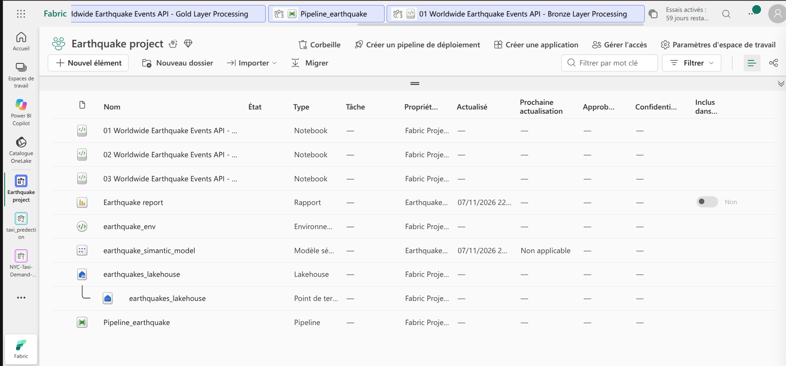
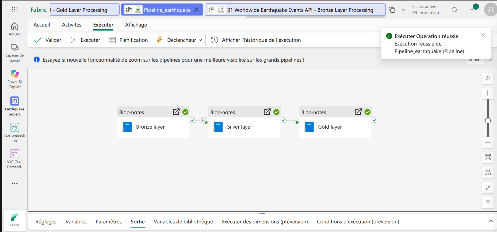
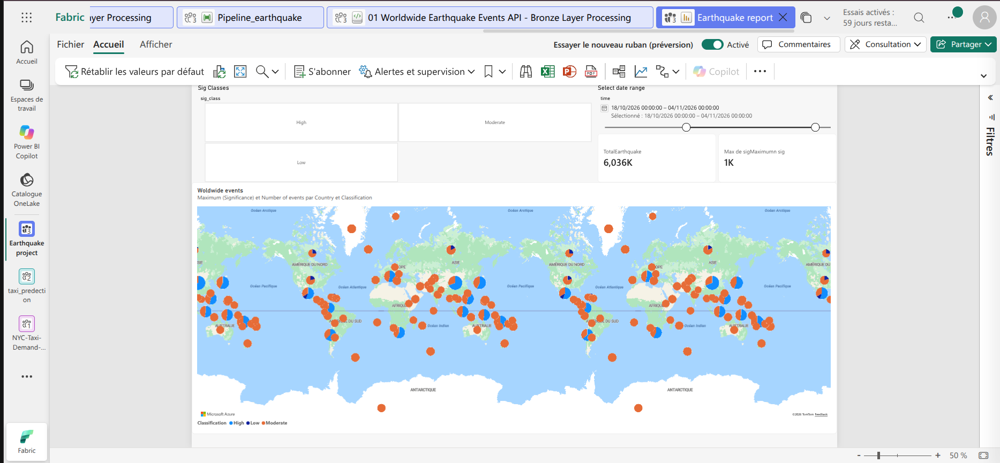

# Projet : Premier pipeline de données Microsoft Fabric pour un dashboard des tremblements de terre dans le monde

## Vue d'ensemble

Ce projet est un premier exemple de pipeline de données dans Microsoft Fabric pour collecter, nettoyer, enrichir et visualiser des données sur les séismes dans le monde. Il utilise l'API USGS Earthquake pour récupérer les événements sismiques, puis il charge les données dans un Lakehouse, les transforme dans les couches Bronze, Silver et Gold, et enfin permet la création d'un tableau de bord analytique.

L'objectif est de démontrer le principe d'un pipeline de données moderne dans Fabric avec :
- un stockage centralisé dans un Data Lakehouse,
- des notebooks pour la transformation des données,
- une couche analytique prête pour le reporting,
- un pipeline Data Factory pour l'orchestration,
- un dashboard pour visualiser les séismes par pays, magnitude et intensité.

---

## Architecture du projet

Le flux de données suit la logique suivante :

1. Source de données : API USGS Earthquake
2. Bronze : récupération des données brutes en format JSON
3. Silver : lecture, nettoyage et structuration des données
4. Gold : enrichissement des données avec le pays et la classification de sévérité
5. Dashboard : visualisation des événements sismiques dans le monde
6. Orchestration : pipeline Data Factory pour exécuter les notebooks dans l'ordre

```text
API USGS Earthquake
        ↓
[Bronze Notebook]
        ↓
[Lakehouse / Files]
        ↓
[Silver Notebook]
        ↓
[Table: earthquake_events_silver]
        ↓
[Gold Notebook]
        ↓
[Table: earthquake_events_gold]
        ↓
[Dashboard / Power BI ]
```

---

## Prérequis

Avant de commencer, il faut avoir :
- un espace de travail Microsoft Fabric actif,
- un Data Lakehouse créé,
- un environnement de notebooks compatible Spark,
- un accès à l'API USGS Earthquake,
- éventuellement un outil de reporting comme Power BI ou un tableau de bord Fabric.

---

## 0. Création du workspace Microsoft Fabric

La première étape consiste à créer un espace de travail Fabric dans lequel seront hébergés le Lakehouse, les notebooks, le pipeline et le dashboard.

### Exemple de workspace Fabric



### Exemple de pipeline de données



### Exemple de dashboard de reporting



---

## 1. Création du Data Lakehouse

Dans Microsoft Fabric :

1. Ouvrir Microsoft Fabric.
2. Créer un nouveau Lakehouse.
3. Nommer par exemple : `EarthquakeLakehouse`.
4. Une fois créé, le Lakehouse sert à stocker :
   - les fichiers JSON bruts de la couche Bronze,
   - les tables transformées Silver,
   - les données enrichies Gold.

Le Lakehouse est la base du projet et permet de centraliser toutes les données avant la visualisation.

---

## 2. Les notebooks du projet

Le projet contient trois notebooks principaux :

- `01 Worldwide Earthquake Events API - Bronze Layer Processing.ipynb` : récupération des données brutes depuis l’API USGS et stockage dans le Lakehouse.
- `02 Worldwide Earthquake Events API - Silver Layer Processing.ipynb` : nettoyage des données et transformation en table exploitable.
- `03 Worldwide Earthquake Events API - Gold Layer Processing.ipynb` : enrichissement des données pour la préparation du reporting et du dashboard.

Ces notebooks représentent les trois couches classiques d’un pipeline de données : Bronze, Silver et Gold.

---

## 3. Les couches de données

### Bronze
La couche Bronze reçoit les données brutes de l’API. Les fichiers sont stockés dans le Lakehouse en format JSON pour garder une trace de la source.

### Silver
La couche Silver nettoie et structure les données. Elle prépare les colonnes utiles à l’analyse et transforme les formats pour faciliter l’exploitation dans Spark.

### Gold
La couche Gold enrichit les données avec des informations métier utiles au reporting, comme le pays ou la classification de sévérité.

---

## 5. Dashboard des séismes dans le monde

Le but du projet est d'afficher un dashboard sur les tremblements de terre dans le monde, avec des vues comme :
- carte mondiale des séismes,
- liste des derniers événements,
- nombre de séismes par pays,
- histogramme par magnitude,
- sévérité des événements,
- évolution temporelle des incidents.

Le dashboard peut être réalisé dans :
- Power BI connecté à la table Gold,
- un rapport Fabric,
- ou une visualisation dans un environnement de reporting.

### Indicateurs utiles
- nombre total de séismes,
- magnitude moyenne,
- séismes récents,
- pays avec plus d'événements,
- événements à forte intensité.

---

## 6. Pipeline Data Factory dans Microsoft Fabric

Le pipeline Data Factory sert à orchestrer l'exécution des notebooks dans le bon ordre.

### Ordre d'exécution conseillé
1. Notebook Bronze : récupérer les données de l'API
2. Notebook Silver : transformer les données
3. Notebook Gold : enrichir et préparer le modèle analytique
4. Dashboard : actualiser les visuels / se connecter aux tables

### Paramètres à prévoir
- `start_date`
- `end_date`

Ces paramètres permettent de lancer le pipeline automatiquement à intervalle régulier, par exemple :
- quotidien,
- hebdomadaire,
- ou selon un déclenchement manuel.

---


## 7. Résumé du projet

Ce projet illustre un cas d'usage complet dans Microsoft Fabric :
- ingestion des données,
- stockage dans un Lakehouse,
- transformations par couches,
- préparation des données pour un reporting,
- mise en place d'un pipeline de données orchestré,
- publication d'un tableau de bord sur les séismes dans le monde.

C'est un bon exemple d'architecture de données moderne pour un premier projet de data engineering dans Fabric.

---

## Conclusion

Ce projet permet de comprendre la logique d'un pipeline de données dans Microsoft Fabric, depuis la collecte de données brutes jusqu'à la création d'un dashboard de reporting. Il couvre la nouvelle approche moderne de l'architecture Data Lakehouse et montre comment les données peuvent être transformées, enrichies et visualisées de manière simple et évolutive.
